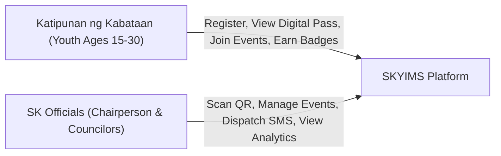
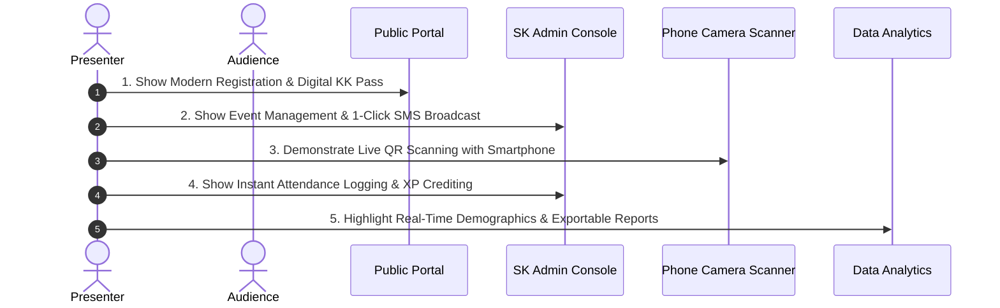

# SKYIMS: Sangguniang Kabataan Youth Information Management System
## Official System Overview & Presentation Guide

> **Tagline:** *"Empowering Barangay Youth Through Modern Digital Governance, Real-Time Community Engagement, and Data-Driven Decision Making."*

---

## 1. Executive Summary: What is SKYIMS?

The **Sangguniang Kabataan Youth Information Management System (SKYIMS)** is an all-in-one digital platform created specifically for Barangay youth councils (Sangguniang Kabataan) and Katipunan ng Kabataan (KK) members.

Historically, barangay youth governance relies on manual paper sign-up sheets, physical logbooks, manual text blasting from personal phones, and unorganized surveys. This leads to lost records, inaccurate attendance counts, difficulty reaching youth during community events, and challenges in planning youth budgets.

**SKYIMS modernizes the entire barangay youth ecosystem:**
1. **For Barangay Youth:** Gives every youth member an instant digital Katipunan ng Kabataan membership card with their own QR code, allows 1-click registration for community events, awards experience points (XP) and badges for volunteering, and provides direct access to barangay surveys.
2. **For SK Officials & Councilors:** Eliminates paper sign-in sheets with a smartphone camera QR scanner, provides an automated SMS text broadcast system to announce activities, maintains an official verified master registry of all youth residents, and automatically turns youth surveys into real-time visual charts for budgeting and program planning.

---

## 2. Who Uses the System?

| User Role | Who They Are | What They Can Do |
| :--- | :--- | :--- |
| **Youth Members (KK)** | Residents aged 15–30 living in the barangay | • Register online and upload ID proof • Access their personal Digital QR Membership Card • Browse and join youth activities with 1 click • Earn XP points and digital achievement badges • Voice out concerns through Needs Assessment surveys |
| **SK Officials & Council** | SK Chairperson, SK Kagawads, Secretary, Treasurer | • Review and verify youth registrations • Turn any smartphone into an on-site QR gate scanner • Send bulk SMS and email event announcements • Organize events aligned with the 9 Youth Centers • Export official Katipunan ng Kabataan masterlists to Excel • View live graphs showing youth education, jobs, and needs |

---

## 3. Complete Feature Breakdown (Non-Technical Guide)

### Feature 1: Online Youth Registration & Digital Profiling
* **What it is:** A simple, mobile-friendly online registration form where youth can register their Katipunan ng Kabataan membership from anywhere using their phone.
* **How it works:**
  - The youth enters their basic details (Full Name, Birthdate, Gender, Civil Status).
  - They choose their **Purok or Sitio** (e.g., Purok 1 to Purok 7, Sitio Crossing).
  - They specify their youth classification (In-School Youth, Out-of-School Youth, Working Youth, Youth with Specific Needs).
  - They declare their voter status (Registered SK Voter, National Voter).
  - They upload a photo or document of their valid ID, school ID, or Barangay Certificate.
  - The system automatically creates their youth profile and marks it for SK review.

### Feature 2: ID Verification Queue (Fraud Prevention)
* **What it is:** An administrative approval room for SK officials to ensure only genuine barangay residents join the official Katipunan ng Kabataan registry.
* **How it works:**
  - When youth sign up with an ID photo, their application enters the **Verification Queue**.
  - SK officials can preview the uploaded ID photo or document with one click.
  - Officials can click **"Verify"** to officially approve the member, or **"Reject"** with a helpful reason if the document is unclear.
  - Once verified, the youth receives an official verification badge on their digital profile.

### Feature 3: Digital KK Membership Card & QR Pass
* **What it is:** A tamper-proof digital ID card that lives on the youth member's smartphone.
* **How it works:**
  - Each youth receives a unique, lifelong Katipunan ng Kabataan Code (e.g., `TIBAO-2026-00001`).
  - The card features an interactive QR code containing their verified membership token.
  - It displays their photo, Purok residence, youth sector, voter status badge, and current gamification level.
  - Youth can present this digital pass on their phone screen or as a printed card at any barangay gym or assembly entrance for instant contactless admission.

### Feature 4: Event & Activity Management
* **What it is:** A digital bulletin board and planning tool for all barangay youth events, sports leagues, seminars, and community projects.
* **How it works:**
  - Officials can create events and categorize them under the **9 National Youth Commission (NYC) Centers of Participation** (such as *Governance & Leadership, Health & Mental Health, Environment & Climate Action, Education, and Sports*).
  - Officials set event dates, venues, maximum capacity limits, and XP reward points.
  - Youth can log in, view full activity mechanics, and register with a single tap.
  - The system automatically tracks how many slots are remaining and builds a real-time attendance roster.

### Feature 5: On-Site Smartphone QR Scanner (Gate Admission)
* **What it is:** A high-speed check-in terminal that turns any SK official's regular smartphone into an intelligent barcode scanner.
* **How it works:**
  - At the entrance of the barangay gym or multi-purpose hall, the official opens the scanner page on their phone and taps **"Start Phone Camera"**.
  - The official points their phone's camera at the youth's digital QR pass.
  - **Instant Feedback:** The scanner vibrates and plays a confirmation chime, showing the youth's name, photo, and Purok on screen.
  - **Duplicate Prevention:** If a youth attempts to scan twice, the system immediately alerts the official with a friendly warning showing the exact time they already checked in.
  - **Walk-in Friendly:** If a youth forgets their phone or has a dead battery, the official can simply type their phone number or name to log them in manually.

### Feature 6: SMS Broadcast & Community Alert Dispatch
* **What it is:** An emergency and announcement dispatch system that sends text messages directly to youth mobile phones.
* **How it works:**
  - When an event is scheduled or announced, officials can click **"Broadcast Alert"**.
  - **Smart Targeting:** Officials can broadcast to:
    1. *All Barangay Youth* (Barangay-wide General Assemblies).
    2. *Registered Attendees Only* (Reminders, schedule updates).
    3. *Specific Purok / Sitio Residents* (Targeted river clean-ups, localized meetings).
  - **Live Preview & Character Counter:** Officials can type custom instructions (e.g., *"Please bring extra water and wear rubber shoes"*), while the system automatically calculates character limits.
  - **Audit Log:** Every sent message is recorded in an audit table showing recipient names, phone numbers, timestamps, and delivery status.
  - **Dual Operation:** Works in **Simulator Mode** (for free, risk-free presentations and tests) or connects to **Semaphore** to send real SMS text messages to Globe, Smart, DITO, TM, and TNT mobile phones.

### Feature 7: Youth Gamification (XP Points, Levels & Badges)
* **What it is:** A fun, motivational rewards system inspired by popular mobile apps that encourages youth to actively participate in barangay activities.
* **How it works:**
  - Every time a youth attends an event, they are automatically awarded Experience Points (e.g., +50 XP or +100 XP).
  - As their points grow, their profile advances through tiers (e.g., *Bronze Volunteer -> Silver Civic Leader -> Gold Youth Champion*).
  - The system automatically unlocks digital achievement badges (e.g., *"Eco Warrior"* for tree planting, *"First Responder"* for disaster drills, *"Sportsman"* for athletic tournaments).
  - This transforms community service from a boring obligation into an engaging, recognized achievement.

### Feature 8: Real-Time Needs Assessment & Demographics Analytics
* **What it is:** An interactive data intelligence dashboard that replaces manual paper survey tabulation.
* **How it works:**
  - Youth answer interactive surveys regarding their livelihood needs, mental health concerns, sports preferences, and education assistance.
  - The system automatically compiles all answers and profile records into **clean visual charts**:
    - *Youth population distribution across each Purok/Sitio.*
    - *Education levels (High School, College, Vocational, Graduate).*
    - *Employment status (In-School, Working, Seeking Job).*
    - *Voter turnout and registration rates.*
  - SK Officials can use these charts during council budget sessions to defend where youth funds should be allocated based on real community evidence.
  - With one click, officials can export full reports and masterlists to Excel/CSV for submission to the DILG, NYC, or Barangay Captain.

---

## 4. Suggested Live Presentation Walkthrough Script

When presenting this project to your evaluators, panel members, or SK officials, follow this recommended 5-minute presentation flow:

### Step 1: The Youth Experience (Registration & Pass)
* **What to say:** *"Good day, everyone. Today we are presenting SKYIMS. First, let's look at the youth experience. In our barangay, youth can visit the portal, register their Katipunan ng Kabataan profile in under 2 minutes, and upload their student or government ID."*
* **What to show:** Open `/youth/profile/digital-id`. Show the handsome Digital KK Membership Card with the live QR code, holographic seal, and voter status badge.

### Step 2: Event Planning & Instant SMS Broadcast
* **What to say:** *"Now, let's step into the shoes of the SK Council. Announcing youth assemblies previously required distributing physical flyers or copying text messages one by one. With SKYIMS, officials create the event under one of the 9 National Youth Commission categories and click 'Broadcast Alert'."*
* **What to show:** Open an Event page (e.g. `/admin/events/4`). Click **Broadcast Alert**. Show the targeting options (All Youth, Registered, or by Purok) and the live SMS message preview card. Then show the **SMS Dispatch Audit Tab** with all youth phone numbers logged.

### Step 3: Live Smartphone QR Gate Scanner
* **What to say:** *"On the day of the event at the Barangay Gym, officials no longer need ballpens and paper logbooks that cause long queues. Any official can open the system on their smartphone and turn on the rear camera."*
* **What to show:** Open `/admin/attendance/scanner` on your mobile phone or laptop. Tap **Start Phone Camera**. Point the camera at a youth QR pass (or click a demo scan button). The system instantly beeps, shows a green confirmation checkmark, and logs the youth's attendance in real time.

### Step 4: Gamification & Youth Recognition
* **What to say:** *"The moment the youth checks in, their profile is instantly credited with XP points and they earn digital badges for community service. This keeps our youth excited and motivated to attend future barangay initiatives."*
* **What to show:** Open `/youth/badges` to show the earned badges and progression tiers.

### Step 5: Data-Driven Decision Making & Analytics
* **What to say:** *"Finally, let's look at the executive view for governance. The SK Council needs data to allocate its 10% Barangay Youth Budget properly. SKYIMS automatically aggregates all youth profiles and surveys into real-time demographic charts."*
* **What to show:** Open `/admin/analytics`. Show the graphs for Purok distribution, education, and employment. Show the **"Export CSV"** button and explain that this report is ready for submission to the DILG, Local Youth Development Office (LYDO), and Sangguniang Barangay.

---

## 5. Key Governance Benefits (Why this System is a Game-Changer)

1. **Republic Act 10742 (SK Reform Act) Compliance:** Directly fulfills the legal mandate of Sangguniang Kabataan councils to maintain an updated, accurate Katipunan ng Kabataan databank.
2. **100% Paperless & Cost-Effective:** Saves thousands of pesos spent on printing paper forms, survey sheets, and manual logbooks every year.
3. **Ghost-Attendee Prevention:** Digital QR verification and one-time scanning timestamps ensure that only actual attendees are counted for snacks, kits, and certificates.
4. **Disaster Readiness & Targeted Alerts:** In case of typhoons, health drives, or community relief operations, the SK council can immediately isolate youth by Purok/Sitio and text them urgent notices.
5. **Transparency & Audit-Readiness:** All transactions, attendances, and SMS notifications are backed by permanent digital audit logs, preventing questions during COA (Commission on Audit) reviews.

---

## 6. Frequently Asked Questions (Cheat Sheet for the Presentation)

* **Q1: What if a youth doesn't have an internet connection during event check-in?**
  * *Answer:* The youth can take a screenshot of their Digital QR Pass or print a physical card once. The admin's scanner will read the screenshot or physical card just as fast!
* **Q2: What if a youth's smartphone battery dies?**
  * *Answer:* The SK Official has a built-in search bar on the scanner screen. They can type the youth's phone number or name, and the system logs their attendance immediately.
* **Q3: Is the SMS feature expensive?**
  * *Answer:* No! For testing and school defense presentations, the system includes a **Zero-Cost Simulator Mode** that logs everything without fees. For real-life barangay deployment, it integrates with Philippine gateways like Semaphore at standard wholesale SMS rates (pennies per text).
* **Q4: How is youth data protected?**
  * *Answer:* Regular youth members can only see their own passes and activities. All administrative tools, masterlists, and ID documents are protected behind strict SK Official role security.
